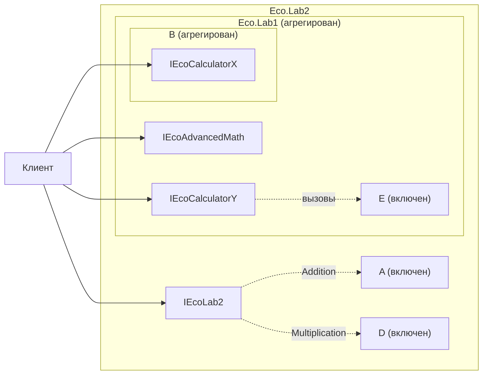

# EcoLab1


Лабораторные работы по технологии АОМК (Eco.Framework, C89).

| Работа | Задание | Отчет | Версия |
|---|---|---|---|
| 1 | Задание 36: решение систем ОДУ методом Рунге-Кутты 4-го порядка (аналог ode45) | [EcoLab1_report.pdf](https://github.com/Zzzpize/EcoLab1/blob/main/report/EcoLab1_report.pdf) | тег [`lab1`](https://github.com/Zzzpize/EcoLab1/tree/lab1) |
| 2 | Включение и агрегирование компонентов калькулятора | [EcoLab2_report.pdf](https://github.com/Zzzpize/EcoLab1/blob/main/report/EcoLab2_report.pdf) | `main` |

## Компоненты

| Компонент | Что делает | CID |
|---|---|---|
| `Eco.Lab1` | метод Рунге-Кутты 4, интерфейсы калькулятора X и Y, поддерживает агрегирование | `039232DC-C935-4369-9250-13DC847FF6CC` |
| `Eco.Lab1DP` | метод Дормана-Принса 4(5) с адаптивным шагом | `AFC67744-F1C3-43AC-891C-A5DA35D14A4A` |
| `Eco.Lab2` | многочлен по схеме Горнера, агрегирует `Eco.Lab1` | `080C4706-D304-40CC-B958-857BFF251504` |
| `Eco.CalculatorA` | сложение и вычитание (X) | `4828F655-2E45-40E7-8121-EBD220DC360E` |
| `Eco.CalculatorB` | X, поддерживает агрегирование | `AE202E54-3CE5-4550-8996-03BD70C62565` |
| `Eco.CalculatorC` | новая версия A с тем же CID: X и Y | `4828F655-2E45-40E7-8121-EBD220DC360E` |
| `Eco.CalculatorD` | умножение и деление (Y), включает B или A | `3A8E4467-7E82-475C-B4A3-719ED8397E61` |
| `Eco.CalculatorE` | Y, агрегирует B | `872FEF1D-E331-4B87-AD44-D1E7C232C2F0` |

Калькуляторы A-E взяты из учебного курса InsideACOM (репозиторий peerf-eco/Eco.Education).

## Лабораторная работа 2: включение и агрегирование



| Где | Прием | Что получается |
|---|---|---|
| Eco.Lab1 -> B | агрегирование | клиент получает `IEcoCalculatorX` компонента B напрямую |
| Eco.Lab1 -> E (или D) | включение | у Eco.Lab1 своя таблица `IEcoCalculatorY`, вызовы передаются внутреннему компоненту, деление на ноль перехватывается |
| Eco.Lab2 -> Eco.Lab1 | агрегирование | через Eco.Lab2 доступны `IEcoAdvancedMath`, X и Y; X идет через два уровня агрегирования |
| Eco.Lab2 -> A, D | включение | Eco.Lab2 сам является клиентом A и D в методе `Horner` |
| C вместо A | замена компонента | сборка `EcoLab2C`: тот же CID, код Eco.Lab2 не меняется |

Все интерфейсы одного компонента возвращают один и тот же `IEcoUnknown` и работают с одним счетчиком ссылок, это проверяется в тестах.

Пример из клиента:

```c
IEcoCalculatorX* pIX = 0;
result = pIEcoLab1->pVTbl->QueryInterface(pIEcoLab1, &IID_IEcoCalculatorX, (void**) &pIX);
c = pIX->pVTbl->Addition(pIX, 3, 5);
```

## Лабораторная работа 1: решение систем ОДУ

Интерфейс `IEcoAdvancedMath` (`Eco.Lab1/SharedFiles/IEcoAdvancedMath.h`):

- `Step`, `Stepf`, `Stepl` - один шаг метода для `double`, `float`, `long double`
- `Solve`, `Solvef`, `Solvel` - решение на отрезке от `t0` до `t1`

Правая часть системы передается как указатель на функцию `f(ctx, t, y, dydt, n)`. Массивы под результат выделяет клиент. Внутри компонентов стандартная библиотека не используется, память берется через `IEcoMemoryAllocator1`.

Осциллятор на отрезке [0, 10], точность около 1e-9:

| Метод | Шагов | Вызовов правой части |
|---|---|---|
| Рунге-Кутта 4 | 1000 | 4000 |
| Дорман-Принс | 214 | 1345 |
| scipy RK45 | 204 | 1280 |

`Eco.Lab1/UnitTestFiles/reference.py` считает эталон для нелинейных задач через `scipy.integrate.solve_ivp`.

## Сборка под Linux

Нужны переменные окружения `ECO_FRAMEWORK` и `ECO_TOOLCHAIN`. Порядок важен: сначала внутренние компоненты, потом внешние.

```
for d in Eco.CalculatorA Eco.CalculatorB Eco.CalculatorC Eco.CalculatorD Eco.CalculatorE Eco.Lab1DP Eco.Lab1 Eco.Lab2; do
    (cd $d/AssemblyFiles/Linux/gcc_v132 && make -f Makefile TARGET=1 DEBUG=0 ARCH=x86_64)
done

cd Eco.Lab1/AssemblyFiles/Linux/gcc_v132
make clean -f MakefileExe TARGET=1 DEBUG=0 ARCH=x86_64
make -f MakefileExe TARGET=1 DEBUG=0 ARCH=x86_64

cd ../../../../Eco.Lab2/AssemblyFiles/Linux/gcc_v132
make clean -f MakefileExe TARGET=1 DEBUG=0 ARCH=x86_64
make -f MakefileExe TARGET=1 DEBUG=0 ARCH=x86_64
make clean -f MakefileExe TARGET=1 DEBUG=0 ARCH=x86_64 OUT_NAME=EcoLab2C
make -f MakefileExe TARGET=1 DEBUG=0 ARCH=x86_64 OUT_NAME=EcoLab2C CALC_A=Eco.CalculatorC
```

`make clean` для клиента нужен, если менялся код компонентов: MakefileExe сам не видит, что библиотеки обновились.

Для Windows, Mac и EcoOS файлы сборки лежат в соседних папках `AssemblyFiles`.

## Запуск

| Программа | Что проверяет | Проверок |
|---|---|---|
| `Eco.Lab1/BuildFiles/Linux/x86_64/StaticRelease/EcoLab1` | методы ОДУ, калькулятор через Eco.Lab1, правила QueryInterface, счетчики ссылок, A, B, D, E по отдельности | 63 |
| `Eco.Lab2/BuildFiles/Linux/x86_64/StaticRelease/EcoLab2` | Горнер, агрегированный Eco.Lab1, правила QueryInterface, общий счетчик, компонент A | 20 |
| `Eco.Lab2/BuildFiles/Linux/x86_64/StaticRelease/EcoLab2C` | то же, но с компонентом C вместо A | 20 |

`EcoLab1` при запуске показывает меню: `1` - тесты, `2` - калькулятор для ОДУ, `0` - выход. Только тесты:

```
printf '1\n0\n' | ./EcoLab1
```
