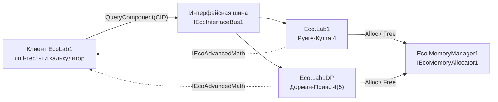

# EcoLab1


Задание 36: решение систем обыкновенных дифференциальных уравнений методом Рунге-Кутты 4-го порядка (аналог ode45 в MATLAB).

Отчет: [report/EcoLab1_report.pdf](https://github.com/Zzzpize/EcoLab1/blob/main/report/EcoLab1_report.pdf)

## Архитектура



Клиент запрашивает у шины компонент по его CID и получает указатель на один и тот же интерфейс `IEcoAdvancedMath`. Какой метод решает задачу, зависит только от выбранного CID.

## Компоненты

Сделано два компонента на технологии АОМК (Eco.Framework, C89), оба реализуют один интерфейс `IEcoAdvancedMath`:

| Компонент | Метод | CID |
|---|---|---|
| `Eco.Lab1` | классический Рунге-Кутта 4-го порядка, постоянный шаг | `039232DC-C935-4369-9250-13DC847FF6CC` |
| `Eco.Lab1DP` | Дорман-Принс 4(5), адаптивный шаг, как в ode45 | `AFC67744-F1C3-43AC-891C-A5DA35D14A4A` |

Внутри компонентов стандартная библиотека не используется, память берется через `IEcoMemoryAllocator1`.

## Интерфейс

`Eco.Lab1/SharedFiles/IEcoAdvancedMath.h`

- `Step`, `Stepf`, `Stepl` - один шаг метода для `double`, `float`, `long double`
- `Solve`, `Solvef`, `Solvel` - решение на отрезке от `t0` до `t1`

Правая часть системы передается как указатель на функцию `f(ctx, t, y, dydt, n)`. Массивы под результат выделяет клиент, их размер задается параметром `capacity`.

## Сборка под Linux

Нужны переменные окружения `ECO_FRAMEWORK` и `ECO_TOOLCHAIN`. Сначала собирается второй компонент, потом первый и клиент:

```
cd Eco.Lab1DP/AssemblyFiles/Linux/gcc_v132
make -f Makefile TARGET=1 DEBUG=0 ARCH=x86_64

cd ../../../../Eco.Lab1/AssemblyFiles/Linux/gcc_v132
make -f Makefile TARGET=1 DEBUG=0 ARCH=x86_64
make clean -f MakefileExe TARGET=1 DEBUG=0 ARCH=x86_64
make -f MakefileExe TARGET=1 DEBUG=0 ARCH=x86_64
```

`make clean` для клиента нужен, если менялся код компонентов: MakefileExe сам не видит, что библиотеки обновились.

Для Windows, Mac и EcoOS файлы сборки лежат в соседних папках `AssemblyFiles`, второй компонент в них тоже подключен.

## Запуск

```
Eco.Lab1/BuildFiles/Linux/x86_64/StaticRelease/EcoLab1
```

Клиент консольный, при запуске показывает меню:

- `1` - unit-тесты обоих компонентов (50 проверок): сравнение с точными решениями через `math.h`, с эталоном из scipy, проверка порядка метода, обработка ошибок, замеры времени
- `2` - калькулятор: выбор задачи, начальных условий, метода и точности
- `0` - выход

Только тесты без меню:

```
printf '1\n0\n' | ./EcoLab1
```

## Эталонные значения

`Eco.Lab1/UnitTestFiles/reference.py` считает эталон для нелинейных задач (Ван дер Поль, Лотка-Вольтерра, маятник) через `scipy.integrate.solve_ivp` и замеряет время scipy на тех же задачах.

## Результаты

Осциллятор на отрезке [0, 10], точность около 1e-9:

| Метод | Шагов | Вызовов правой части |
|---|---|---|
| Рунге-Кутта 4 | 1000 | 4000 |
| Дорман-Принс | 214 | 1345 |
| scipy RK45 | 204 | 1280 |

Таблицы точности, графики и замеры времени есть в [отчете](https://github.com/Zzzpize/EcoLab1/blob/main/report/EcoLab1_report.pdf).
